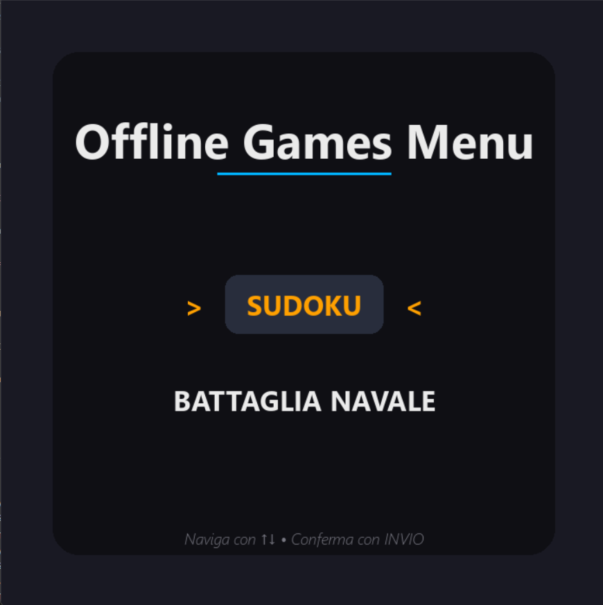
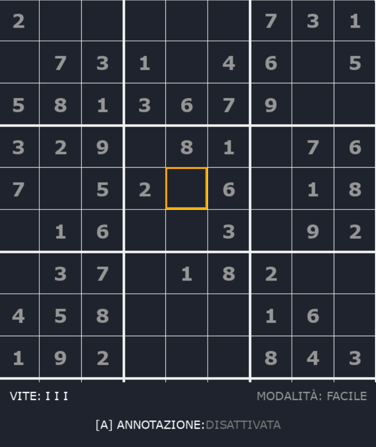
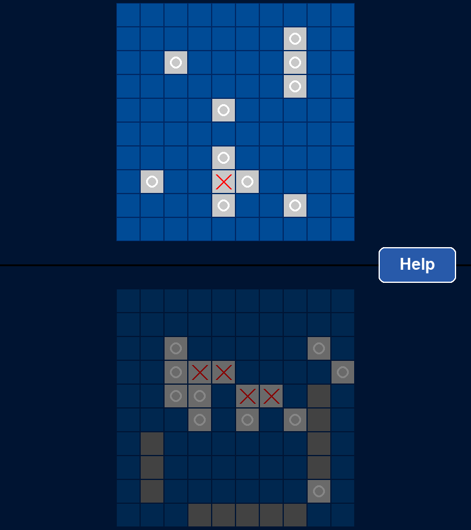

# Quality Development - Offline Games 🕹️
Questo repository è stato creato per fornire un template Python dedicato allo **sviluppo di giochi offline**, includendo <ins>pipeline di automazione e istruzioni</ins> per i test con pytest.

## How to start (one-time step)
Per **scaricare** il progetto e configurare il tuo ambiente locale, esegui questi comandi:

```Plaintext
git clone git@github.com:USERNAME/nome-repo.git
cd nome-repo
git pull origin main
```
**Setup del virtualenv**:
```Plaintext
python -m venv .venv
source .venv/bin/activate    # su Linux/macOS
.venv\Scripts\activate       # su Windows
pip install -r requirements.txt        # solo dipendenze runtime
pip install -r requirements_dev.txt    # runtime + strumenti di sviluppo (lint, test)
```
Avvio: `python src/main_menu.py` (oppure direttamente `src/sudoku.py` / `src/battleship.py`).

## Architettura
Ogni gioco è un pacchetto con responsabilità separate (SRP) e dipendenze iniettabili (DIP):

```
src/
├── main_menu.py, sudoku.py, battleship.py   # entry point sottili
├── common/launcher.py                       # GameLauncher (Protocol) + SubprocessLauncher
├── menu/        catalog.py · view.py · app.py
├── sudoku_game/ config · engine · state · renderer · app
└── battleship_game/
    ├── config.py      costanti e layout
    ├── model.py       Cell, Ship, Board, Orientation (dominio puro)
    ├── placement.py   FleetPlacer (Protocol) + RandomFleetPlacer
    ├── ai.py          ShootingStrategy (Protocol) + HuntTargetStrategy
    ├── game.py        BattleshipGame: regole, turni, fasi (nessun Pygame)
    ├── board_view.py  rendering di una plancia
    ├── screens.py     schermate e overlay
    └── app.py         controller: eventi, timer del nemico, loop
```
La logica di gioco non dipende da Pygame, quindi è testabile senza finestra; non ci sono variabili globali.

## Pipeline & Repository Structure
Per far sì che le automazioni funzionino correttamente, abbiamo mantenuto la struttura del template originale. Le **pipeline** si occupano di **verificare la qualità del codice** ad ogni modifica.

**Directory Structure**: Assicurati di non spostare la cartella .github/.

**Workflow**: Le definizioni delle pipeline si trovano in:

```
.github/workflows
```
## How to make a commit
Quando lavori al tuo gioco, effettua dei <ins>commit frequenti e descrittivi</ins>. Usa i **Conventional Commits** come in questi esempi:

```
git add src/game_logic.py
git commit -m 'feat(sudoku): add grid generation logic'
```
Altri esempi di messaggi approvati:
```
fix(battleship): prevent ships from overlapping

docs(readme): update installation guide

test(logic): add unit tests for score calculation
```
## Software Testing & Coverage
La qualità è fondamentale. Usiamo **pytest** per assicurarci che tutto funzioni e per monitorare **quanto codice è coperto dai test**.

Per far girare i test e vedere il report:

```
pytest --cov --cov-report=term-missing
```
La CI esegue i test (`test.yml`) e fallisce se la coverage scende sotto la soglia definita in `pyproject.toml` (`fail_under`, oggi 90%).

Controlli di qualità eseguiti in CI (`lint.yml`): `pylint`, `flake8`, `mypy` (con `disallow_untyped_defs`), `black`, `isort`.

⚠️ Il progetto mantiene una code coverage minima del 90%.

# Il Progetto: Offline Games
## Main Menu


## Sudoku


## Battaglia Navale


Il software è una raccolta di **giochi classici** sviluppati puramente in **Python**, pensati per essere giocati **senza connessione internet**.

**Sudoku**: Una sfida logica con generazione dinamica delle griglie.

**Battaglia Navale**: Il classico gioco di strategia riprodotto in digitale.

Per offrire un'esperienza utente superiore e un'interfaccia grafica accattivante, il progetto utilizza:
```
Libreria Grafica di riferimento:  [pygame] 
```


